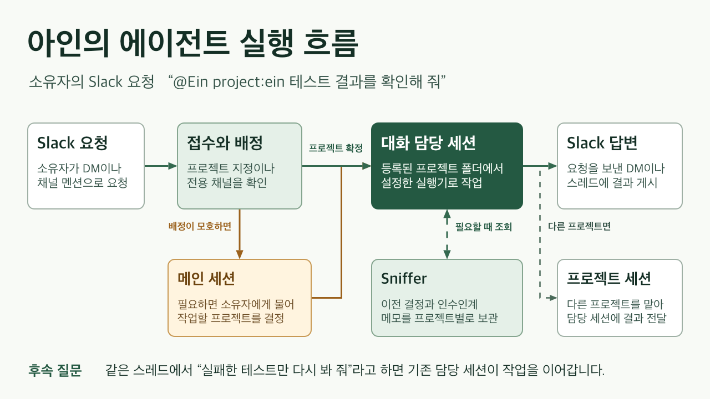

<p align="center">
  
</p>

# project Ein

**project Ein(아인)**은 Claude, Codex, Antigravity를 오가며 개발할 때 필요한 도구를 한곳에 모아 설치할 수 있도록 만든 프로젝트입니다. 이름은 《카우보이 비밥》의 코기 아인에서 따왔습니다.

## 지금 쓸 수 있는 도구

**Ein Slack CLI**는 Slack 대화를 로컬 코딩 에이전트에 연결합니다. 소유자가 채널에서 봇을 멘션해 `project:ein 테스트 결과를 확인해 줘`라고 보내면, 아인이 등록된 프로젝트 폴더에서 작업 세션을 열고 결과를 같은 스레드에 답합니다. 그 스레드에서 “실패한 테스트만 다시 봐 줘”라고 하면 같은 세션이 작업을 이어갑니다. [Slack CLI 운영 가이드](docs/slack-cli.md)

Slack 작업을 맡길 실행기는 설정의 `runner`에서 Claude Code(`claude`), Codex CLI(`codex`), OMO(`omo`) 중 하나를 고릅니다. Antigravity CLI에서 프로젝트 기억을 사용하려면 등록한 폴더의 터미널에서 `ein run agy`를 실행하세요.

새 작업 세션의 기본 모델은 Claude Code의 `claude-opus-5-5`, Codex의 `gpt-6.2-astra`, Antigravity의 `gemini-4-carbon`입니다. 바꾸려는 실행기만 Ein 설정의 `models`에 지정하세요. 예를 들어 `"models": { "claude": "sonnet" }`은 새 Claude 작업을 Sonnet으로 시작합니다. OMO는 `models.omo`를 생략하면 자체 모델 설정을 사용합니다. 추론 강도는 각 실행기의 설정을 따릅니다. [전체 설정 예제](examples/config.json)

**Sniffer**는 프로젝트별 장기 기억을 저장하고 검색합니다. Slack에서 내린 결정을 같은 프로젝트의 터미널 세션에서 찾아볼 수 있습니다. Slack 없이 시작하려면 작업 폴더를 등록하고 첫 기억을 저장해 보세요. [Sniffer에서 첫 기억 저장·검색하기](sniffer/README.md#slack-없이-프로젝트-기억-사용하기)

## 에이전트 실행 흐름



## Mac에 설치하기

**설치하거나 업데이트하려면** Mac 터미널에서 아래 한 줄을 실행하세요. 최신 릴리스의 Apple Silicon 또는 Intel 패키지를 자동으로 골라 SHA-256을 확인하고 `~/.ein`에 설치합니다. 로컬 Git이 필요하며, Bun과 Go는 따로 설치할 필요가 없습니다.

```sh
curl -fsSL https://github.com/wintermocha/Ein/releases/latest/download/install-release.sh | sh
```

`~/.ein/bin/ein --help`로 설치를 확인하고, Slack에 연결하려면 `~/.ein/bin/ein setup`을 실행하세요. 어느 폴더에서든 `ein`으로 부르려면 `~/.zshrc`에 `export PATH="$HOME/.ein/bin:$PATH"`를 추가하고 새 터미널을 여세요. Codex·Antigravity CLI 자동 회상 hook도 등록하려면 위 명령 끝의 `| sh`를 `| sh -s -- --with-hooks`로 바꾸세요.

**수동 설치**는 [GitHub Releases](https://github.com/wintermocha/Ein/releases)에서 원하는 버전의 `ein-darwin-arm64.tar.gz`(Apple Silicon) 또는 `ein-darwin-amd64.tar.gz`(Intel)를 내려받아 압축을 풀고, 그 폴더에서 `sh install.sh`를 실행하세요. `main`이 갱신될 때마다 GitHub Actions가 두 Mac용 패키지를 빌드하고 각각 설치 테스트를 통과하면 릴리스를 게시합니다.

**소스에서 배포본을 만들려면** Mac에 Git, Bun, Go 1.26 이상을 준비하고 저장소 루트에서 `bun run package`를 실행합니다. `dist/`에 이 Mac의 CPU에 맞는 압축 파일이 생깁니다. 압축을 풀고 위 설치 절차를 따르면 됩니다.

## 소스에서 첫 Slack 이벤트 받아 보기

Bun이 설치된 환경에서 저장소 루트로 이동해 다음 명령을 실행합니다. 예제는 로컬 파일을 사용하므로 Slack 계정이나 API 토큰 없이 실행할 수 있습니다.

```sh
bun install --frozen-lockfile
EIN_CONFIG=examples/config.json bun run ein check
EIN_CONFIG=examples/config.json bun run ein replay < examples/events.jsonl
```

`check`가 `Ein config OK (offline).`을 출력하면 설정을 읽은 것입니다. `replay`는 예제 이벤트 다섯 건을 읽어 봇 멘션(`mention`), 같은 스레드의 후속 질문(`own-thread`), 답글에 달린 반응(`reaction`)을 한 줄씩 출력합니다. 설치본으로도 압축을 푼 폴더에서 `bun run ein`을 `ein`으로 바꿔 두 예제를 실행할 수 있습니다.

## 내 Slack에 연결하기

아래는 설치본 기준입니다. 소스에서 실행할 때는 저장소 루트에서 `ein` 대신 `bun run ein`을 사용하세요.

```sh
ein setup
```

안내에 따라 Slack 앱을 만들거나 기존 앱을 선택하고, 앱 토큰(`xapp-`)과 봇 토큰(`xoxb-`)을 입력한 뒤 Ein에게 확인 코드를 DM으로 보냅니다. 터미널에서 소유자 계정을 확인하면 Ein이 같은 DM에 **“연결됐어요”**라고 답합니다. 중간에 멈췄다면 `ein setup --status`로 현재 단계를 확인하고 `ein setup`으로 이어갑니다.

Codex에서 이 저장소를 열고 **“`$ein-setup`으로 Slack 연결해 줘”**라고 요청해도 됩니다. 에이전트가 한 단계씩 안내하고, 토큰은 내 터미널에서 비공개로 입력합니다. [온보딩 스킬](.agents/skills/ein-setup/SKILL.md)

**DM 수신을 확인하려면** `ein listen`을 실행한 뒤 Ein에게 새 DM을 보내세요. 터미널에 `INBOUND dm`으로 시작하는 줄과 메시지 본문이 출력됩니다.

### Slack에서 프로젝트 작업 맡기기

1. Mac에 `herdr`와 사용할 실행기 하나(`claude`, `codex`, `omo`)를 설치해 터미널의 `PATH`에 둡니다.
2. 온보딩으로 만든 `~/.config/ein/config.json`(별도 지정 시 `EIN_CONFIG`)에 아래 두 필드를 추가합니다. 이 예제는 `codex`로 `ein` 프로젝트를 여는 설정입니다. `path`를 실제 프로젝트 폴더의 절대 경로로 바꾸세요.

   ```json
   {
     "runner": "codex",
     "projects": {
       "ein": { "path": "/Users/me/work/ein" }
     }
   }
   ```

3. `ein check`로 설정을 확인하세요. 온보딩에서 herdr 서버 준비를 보류했거나 Mac을 재시작했다면 먼저 서버를 시작하세요. `listen`이 실행 중이면 `Ctrl-C`로 종료한 뒤 `ein orchestrate`를 실행합니다. 두 명령을 함께 실행하면 Slack 이벤트가 두 연결에 나뉩니다. [herdr 서버 시작 방법](docs/slack-cli.md#작업-세션과-slack-답변-연결)
4. 소유자 계정에서 Ein에게 `project:ein 테스트 결과를 확인해 줘`라고 DM을 보내면 등록한 폴더에서 작업하고 같은 DM에 답합니다. 진행 중인 작업을 보려면 다른 터미널에서 `herdr session attach ein`을 실행하고 `ein setup --status`에 표시된 워크스페이스를 여세요.

채널에서 멘션을 받으려면 봇을 채널에 초대하고 채널 ID를 `watchChannels`에 추가한 뒤 수신기를 다시 시작하세요. 한 프로젝트의 전용 채널이라면 같은 ID를 `projects.ein.channels`에도 넣어 `project:ein` 지정을 생략할 수 있습니다. [전체 설정 예제](examples/config.json)
