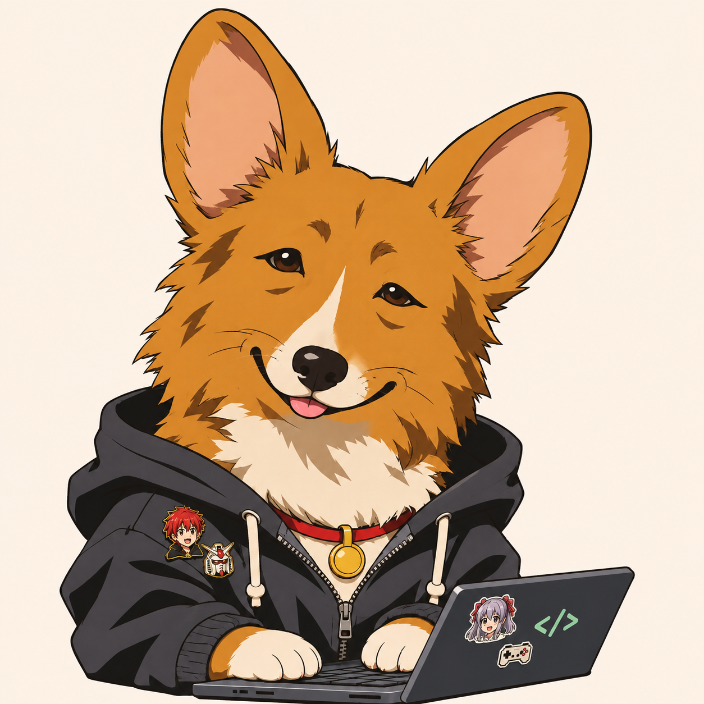

<p align="center">
  
</p>

# project Ein

**project Ein(아인)**은 Claude, Codex, Antigravity를 오가며 개발할 때 필요한 도구를 한곳에 모아 설치할 수 있도록 만든 프로젝트입니다. 이름은 《카우보이 비밥》의 코기 아인에서 따왔습니다.

## 지금 쓸 수 있는 도구

**Ein Slack CLI**는 Slack 대화를 로컬 코딩 에이전트에 연결합니다. 예를 들어 Slack에서 봇을 멘션해 `project:ein 테스트 결과를 확인해 줘`라고 보내면, 아인이 등록된 프로젝트 폴더에서 작업 세션을 열고 결과를 같은 스레드에 답합니다. 그 스레드에서 “실패한 테스트만 다시 봐 줘”라고 하면 같은 세션이 작업을 이어갑니다.

Slack 작업을 맡길 실행기는 설정의 `runner`에서 하나를 고릅니다. 현재 선택지는 Claude Code(`claude`), Codex CLI(`codex`), OMO(`omo`)입니다. Antigravity에서도 프로젝트를 열고 아래 명령을 실행할 수 있습니다. Slack 실행기로 Antigravity를 직접 지정하는 기능은 아직 없습니다.

## 설치하고 첫 이벤트 받아 보기

Bun이 설치된 환경에서 저장소 루트로 이동해 다음 명령을 실행합니다. 예제는 로컬 파일을 사용하므로 Slack 계정이나 API 토큰 없이 실행할 수 있습니다.

```sh
bun install --frozen-lockfile
EIN_CONFIG=examples/config.json bun run ein check
EIN_CONFIG=examples/config.json bun run ein replay < examples/events.jsonl
```

`check`가 `Ein config OK (offline).`을 출력하면 설정을 읽은 것입니다. `replay`는 예제 이벤트 다섯 건을 읽어 봇 멘션(`mention`), 같은 스레드의 후속 질문(`own-thread`), 답글에 달린 반응(`reaction`)을 한 줄씩 출력합니다.

## 내 Slack에 연결하기

예제 설정의 팀·봇·소유자 ID와 프로젝트 경로를 실제 값으로 바꾸고 Slack 앱 토큰과 봇 토큰을 준비합니다. 메시지를 터미널에서 받으려면 `bun run ein listen`을 실행합니다. 에이전트가 답하게 하려면 선택한 실행기와 `herdr`를 준비한 뒤 `bun run ein orchestrate`를 실행합니다. 앱 생성부터 첫 답글까지의 순서는 운영 가이드에 있습니다. [Slack CLI 운영 가이드](docs/slack-cli.md) · [설정 예제](examples/config.json) · [Slack 앱 매니페스트](examples/slack-manifest.json)
