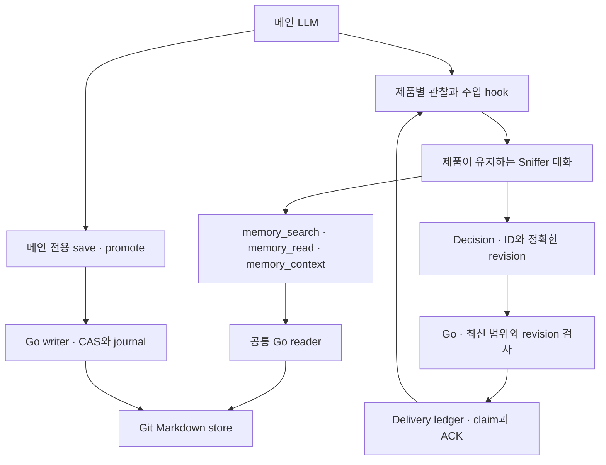
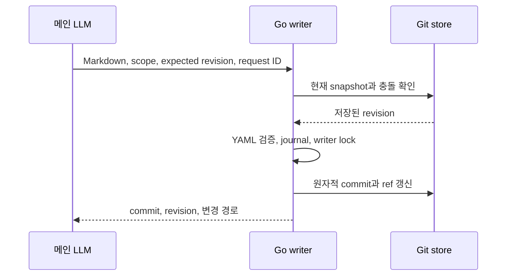

# Ein / Sniffer v0.4.0 상세 구조 검토

기준일: 2026-11-26 KST. 이 문서의 구현 설명은 이 패키지의 실제 소스에 대응합니다. 외부 제품 계약은 끝의 공식 자료와 `PROVENANCE.md`를 참고합니다.

## 1. 확정한 설계

**기억 에이전트는 읽기 전용, 저장은 메인 LLM의 요청입니다. 공통 Go 엔진을 유지하고 모델 실행·대화 관리는 제품별 native 기능으로 분리합니다.**

Ein은 상위 프로젝트 이름입니다. Sniffer는 그 안의 장기 기억 구성요소이자 실행 명령입니다. Go 프로세스 자체를 LLM 에이전트라고 부르지 않습니다. Go가 `memory_search`를 실행하면 허용된 기억을 어휘 검색하고, 모델이 어떤 질의를 사용할지와 무엇을 전달할지를 판단합니다.

| 책임 | 담당 | 구현 위치 |
| --- | --- | --- |
| 현재 대화에서 필요한 기억 판단 | 제품의 memory LLM | Claude native agent / Codex thread / agy conversation |
| 모델·대화 이력·일반적인 캐시 사용 | 제품 런타임 | 제품별 native API |
| 관찰 전달·호출 순서·취소 연결 | 제품 adapter | Claude TS mod, `internal/native`, `internal/worker` |
| 한영 검색·범위 제한·본문 페이지 조회 | 공통 Go reader | `internal/search`, `internal/recall` |
| 저장 필요성과 저장 내용 결정 | 메인 LLM | 별도 main writer 도구 또는 CLI |
| YAML 검증·Git commit·충돌·복구 | 공통 Go writer | `internal/store`, `internal/model` |
| 버전·범위 재검증·전달 중복 방지 | 공통 Go core | `internal/recall`, `internal/ledger` |

## 2. 전체 연결도

읽기 agent에게는 저장 도구를 제공하지 않습니다. Decision의 본문을 그대로 주입하지도 않습니다. 최종 ID와 revision을 검증한 뒤 Go가 committed 원문을 직접 조립합니다. 저장 경로는 이 회상 경로와 분리됩니다.

### 제품마다 다른 연결

| 구분 | Claude Code | Codex | agy CLI |
| --- | --- | --- | --- |
| 연결 계층 | TS mod | command hooks + 얇은 Go coordinator | command hooks + 얇은 Go coordinator |
| 기억 대화 | `agent.spawn` 후 같은 ID에 `session.send` | 같은 app-server process의 `thread/start`, 이어지는 `turn/start` | 계속 열린 stream-json stdin, 같은 conversation ID |
| 모델 | Haiku 5.5 / medium | GPT-6 Luna / low / Fast | Gemini `gemini-4-hydrogen-low` |
| reader 접점 | native custom tools → Go `bridge tool` | dynamic tool callback → Go reader | 전용 reader MCP → Go reader |
| 상주 Go HTTP worker | 없음 | 있음, 이벤트/취소 전달용 | 있음, 이벤트/취소 전달용 |
| 메인 저장 접점 | main-only native custom tools | main writer MCP 또는 명시적 CLI | main writer MCP 또는 명시적 CLI |
| 전달 위치 | prompt 또는 실제 main tool 결과 경계 | 공식 추가 context 지원 hook | `PreInvocation.injectSteps` |

Codex app-server를 새로 띄운다고 이미 실행 중인 메인 CLI의 thread에 자동으로 붙는 것은 아닙니다. 메인 hook에서 제한된 관찰을 전용 memory thread로 전달합니다. agy도 메인 conversation의 내부 기록 전체를 자동 공유하는 기능으로 구현하지 않았습니다.

## 3. 회상 흐름과 Go의 역할

1. 현재 프로젝트 경로와 제품·메인 세션을 바인딩합니다. 등록되지 않았거나 서로 다른 프로젝트 root가 섞인 workspace는 거절합니다.
2. adapter가 사용자 요청과 제한된 관찰을 memory agent에 전달합니다. Go는 미리 후보를 골라 모델의 검색 범위를 고정하지 않습니다.
3. agent가 `memory_search`로 질의를 정하고, 필요하면 한영 표현을 바꿔 다시 검색합니다. `memory_read`로 본문을 페이지 단위로 확인할 수 있습니다.
4. agent가 최대 세 개의 `{id, revision}` 또는 `none`을 반환합니다. 저장·승격을 뜻하는 Decision은 허용하지 않습니다.
5. 실제 주입 직전에 현재 scope tree, 기억 blob revision, 더 가까운 scope의 같은 key 규칙을 다시 검사합니다.
6. 전달 ledger에 claim을 만든 뒤, Go가 만든 원문 reference를 adapter에 돌려줍니다.
7. adapter의 전달 반환을 확인한 범위에서 emitted를 기록합니다. 불확실한 전달은 uncertain으로 남습니다.

따라서 Go의 키워드 점수는 검색 도구의 구현입니다. 어떤 질의가 필요한지와 어떤 기억이 현재 맥락에 유용한지는 LLM의 판단입니다. YAML schema·scope·버전·용량·중복 처리는 결정적인 규칙이므로 Go에 남겼습니다.

### 읽기 도구

| 도구 | 입력·출력 | 제한 |
| --- | --- | --- |
| `memory_context` | 현재 bounded observation | 다른 세션의 대화를 열지 않음 |
| `memory_search` | 질의, 최대 20개 결과, description·1,000문자 발췌·revision | 현재 project와 조상 scope만 |
| `memory_read` | ID, 문자 offset와 limit | 기본 6,000자, 최대 16,000자/회, 계속 읽기 가능 |

한 요청에서 도구 시도는 최대 12회, 결과 합계는 192 KiB입니다. 실패한 도구 시도도 예산에 포함합니다. body 전체가 커도 페이지로 읽을 수 있지만 최종 자동 주입에는 기본 12 KiB 예산이 있어 큰 기억은 제외될 수 있습니다. 중요한 규칙은 독립적으로 읽을 수 있는 작은 문서로 나누는 편이 적합합니다.

## 4. 세션 수명과 정상 재사용

### Claude

TS mod가 native agent를 등록·생성합니다. 정상 완료한 agent의 ID를 유지하고 다음 관찰을 같은 대화에 보냅니다. agent의 도구 목록과 실제 호출을 모두 reader로 제한합니다. `agent.report`는 mod가 소비하므로 원시 Decision이 메인 대화에 별도 메시지로 들어가지 않습니다.

메인 턴 종료 시 실행 중인 작업은 취소합니다. 이미 정상 완료한 native 대화는 다음 요청에서 재사용할 수 있습니다. 세션 종료·압축·경로 변경 시 agent와 요청 세대를 정리합니다. stale report와 retired agent의 도구 호출은 거절합니다. 구체적인 hook 동작과 대기 예산은 `CLAUDE-MOD.md`에 있습니다.

### Codex와 agy

`sniffer run`이 메인 CLI와 coordinator를 연결합니다. coordinator가 메인 conversation ID별로 native memory Session을 하나씩 관리합니다. 정상 요청은 같은 Session을 재사용합니다. busy Session에 새 Run을 동시에 보내지 않습니다.

모델 호출 취소·프로토콜 실패로 해당 대화의 상태를 확신할 수 없으면 transport를 종료합니다. 다음 요청에는 새 native 대화를 만들고, 최근 main 관찰의 제한된 부분을 명시적인 복구 seed로 제공합니다. 이전 모델의 사고·도구 응답·전체 conversation을 완전히 복원하는 기능은 아닙니다.

launcher가 종료되거나 강제로 사라지면 owner pipe EOF가 coordinator에 전달됩니다. coordinator는 listener와 소유한 native process를 정리합니다. Git 기억과 ledger는 남고 실행 중 token·runtime 파일은 정리됩니다. 메인 CLI의 단일 Stop 이벤트는 전체 worker의 종료가 아니라 현재 회상 작업의 취소입니다.

## 5. 관찰과 주입의 차이

memory agent를 따로 유지해도 메인 LLM의 숨겨진 사고를 읽는 것은 아닙니다. adapter가 제품 API로 제공받은 자료만 전달합니다.

| 제품 | 관찰하는 자료 | 이 구현의 한계 |
| --- | --- | --- |
| Claude | 최근 공개 session message와 main tool 관찰, 새 사용자 요청 | native hook 계약 범위, bounded excerpt |
| Codex | 사용자 prompt, 허용된 tool metadata, PostToolUse의 제한된 텍스트 결과 | 전체 transcript를 재생하지 않음 |
| agy | lastUserInput, 공식 toolCall metadata와 오류 | 공식 hook에 없는 tool 결과 본문을 만들어내지 않음; transcript 파일 읽기 미구현 |

Codex tool 결과 발췌는 최대 4 KiB입니다. 셸 명령 본문, 새 파일에 쓰려던 본문, 비텍스트 MCP 결과는 관찰에서 제외합니다. 흔한 토큰·비밀번호 패턴 가림은 보조 기능이며 모든 비밀을 탐지하는 보장은 아닙니다.

대기 시간 안에 결과가 없으면 메인 작업을 계속합니다. 늦은 결과는 다음 허용된 hook 경계에서 전달합니다. 도구 호출 없이 끝나는 짧은 턴은 늦은 기억을 활용하지 못할 수 있습니다. 전달을 위해 가짜 사용자 턴을 만들거나 메인 세션을 임의로 다시 깨우지 않습니다.

## 6. 저장 경로

메인 LLM이 기억으로 남길 내용과 범위를 결정합니다. Claude에서는 main-only `memory_save` / `memory_promote`, Codex/agy에서는 main에만 연결한 writer MCP 또는 `sniffer memory save/promote`를 사용합니다.

`--if-revision new`는 새 문서 생성에만 사용합니다. 수정에는 실제 blob revision이 필요합니다. 같은 request ID와 같은 입력의 재시도는 기존 결과를 반환하고, 같은 ID의 다른 입력은 거부합니다. 원문 분리·상향 범위를 agent가 임의로 자동 변경하지 않습니다. 전체·부분 승격은 명시적인 별도 저장 요청입니다.

메모리 agent의 제품 권한 제한이 저장 경계를 먼저 적용합니다. Go role·MCP profile·bridge의 main/agent 검사도 추가로 적용합니다. `role:main` 같은 문자열 하나가 OS 수준 인증을 제공하는 것은 아니며, 동일 사용자가 임의의 프로세스를 실행하는 상황을 격리하는 보안 제품으로 설명하지 않습니다.

## 7. 중앙 저장과 공유 범위

| 경로 | 내용 |
| --- | --- |
| `~/.ein/config.json` | 실제 프로젝트 경로, 제품 실행 파일, 예산 |
| `~/.ein/bin/sniffer` | 공통 Go 실행 파일 |
| `~/.ein/adapters/` | Claude mod와 CLI hook 예제 |
| `~/.ein/memory/store/` | 별도 Git 저장소, Markdown과 scope registry |
| `~/.ein/memory/state/sessions/` | 현재 request·bounded observation·도구 예산, private 파일 |
| `~/.ein/memory/state/deliveries/` | 내용 해시와 전달 영수증, 본문 없음 |
| `~/.ein/memory/state/transactions/` | 저장 journal, 복구용 변경 전후 bytes 포함 |
| `~/.ein/run/<run-id>/` | Codex/agy 연결 token·native runtime·현재 context |

읽기 전용은 기억 내용과 Git을 바꾸지 않는다는 뜻입니다. agent 대화 진행을 위한 로컬 request/도구 예산 metadata는 변경됩니다. 일반 `memory search/list/read` 자체는 세션·ledger 파일도 만들지 않습니다.

논리 구조는 `global → group → group → project` 형태입니다. 물리 폴더의 부모를 자동 공유 범위로 쓰지 않습니다. 같은 project ID에 여러 worktree root를 등록할 수 있고, 별도 project의 기억은 조회 대상에서 제외합니다. 상위 group이나 global로 승격된 기억만 해당 자손 프로젝트에서 공유합니다.

## 8. 중복과 변경의 의미

전달 키는 제품, 메인 conversation, project, context epoch, 기억 ID와 내용 해시를 사용합니다. 전체 Git HEAD가 바뀌었다는 이유만으로 같은 내용이 반복 전달되지는 않습니다. scope 이동·timestamp·alias만 바뀐 경우와 실제 description·본문·key의 변경을 구분합니다.

claim 후 ACK가 사라져도 자동 중복을 억제합니다. 이는 at-most-once handoff이며 모델이 반드시 읽고 사용했다는 exactly-once 보장은 아닙니다. 출력 직전 장애로 전달이 누락될 수 있으며, 필요하면 명시적 read 또는 Codex/agy 활성 run의 `memory recall --force`로 확인합니다.

압축/reset은 epoch를 올립니다. 동일한 reset event ID는 한 번만 적용합니다. 늦은 이전 request의 cancel/reset은 현재 request를 종료하거나 ledger를 재설정하지 않습니다. 새 prompt, 도구 완료, 취소가 겹치는 경우를 자동 시험에 포함합니다.

## 9. 캐시, 비용, 인증

native 대화 재사용은 요청별 임시 프로세스에 비해 대화 이력을 유지하고 안정적인 프롬프트 앞부분을 반복할 기회를 줍니다. 그 자체로 cache hit을 보장하지 않습니다. 모델·계정·프롬프트 prefix·제품 요청 형식·TTL 등에 따라 달라지며 이 배포에서는 실제 cache hit 비율을 측정하지 않았습니다.

Codex/agy adapter는 제품이 보고한 usage를 읽을 수 있게 구현했습니다. 이 값은 자동 청구 계산 기능이 아니며 제품별 input/cached 계수 의미가 다릅니다. Codex total input에는 cached subset이 포함되어 있으므로 다시 더하면 안 됩니다. agy 누적 결과 계수는 차이만 누적합니다.

인증은 제품이 소유합니다. Claude native agent는 같은 제품 세션의 인증을 사용하고 Codex/agy 자식 프로세스는 같은 OS 사용자·정상 제품 환경을 상속합니다. 인증 JSON·토큰을 Sniffer가 읽어 옮기지 않습니다. 환경변수나 제품 프로필이 다른 계정을 가리키는 경우까지 동일 계정을 강제로 보장하지 않습니다.

## 10. 검증과 남은 범위

Go 저장·검색·전달 기록은 실제 Git과 파일 시스템으로 시험합니다. 제품별 어댑터는 테스트용 CLI 프로세스로 핸드셰이크, 두 턴 유지, reader 호출, 취소와 도구 권한 변경을 시험합니다. Claude mod는 별도의 hook 계약 테스트를 제공합니다. [검증과 데모](../README.md#검증과-출처)

실제 Mac 실행, Claude mod 실로딩, 세 제품의 로그인·모델 entitlement·live response는 별도 현장 검증 범위입니다. Codex experimental dynamic tools와 제품 hook/API는 버전에 따라 바뀔 수 있습니다. agy는 전용 guard를 위해 customizations를 상속하며 사용자 전역 customization도 로드될 수 있습니다. 제품의 policy가 제한을 덮어쓰거나 inventory가 예상과 다르면 해당 memory 결과를 사용하지 않습니다. agy guard가 OS sandbox를 대체한다고 주장하지 않습니다.

GUI, 원격 공유 서버, 자동 Git 동기화, 전체 대화 transcript 수집, 과거 구현 자동 마이그레이션은 포함하지 않습니다. 필요한 기능을 숨긴 채 지원한 것으로 표시하지 않았습니다.

## 구현 및 API 근거

- `internal/native/types.go`, `decision.go`: 모델, reader tool schema, Decision 계약.
- `internal/recall/service.go`, `tools.go`: 검색 호출, generation, 최신 검증, 전달.
- `internal/worker/engine.go`: Codex/agy 이벤트 연결과 native Session 수명.
- `adapters/claude-mod/hooks/register.ts`: Claude native agent와 main-only writer.
- Claude: https://code.claude.com/docs/en/plugins/mods/api
- Claude events: https://code.claude.com/docs/en/plugins/mods/events
- Codex: https://learn.chatgpt.com/docs/app-server
- Codex hooks: https://learn.chatgpt.com/docs/hooks
- agy: https://antigravity.google/docs/cli/headless/
- agy hooks: https://antigravity.google/docs/hooks
