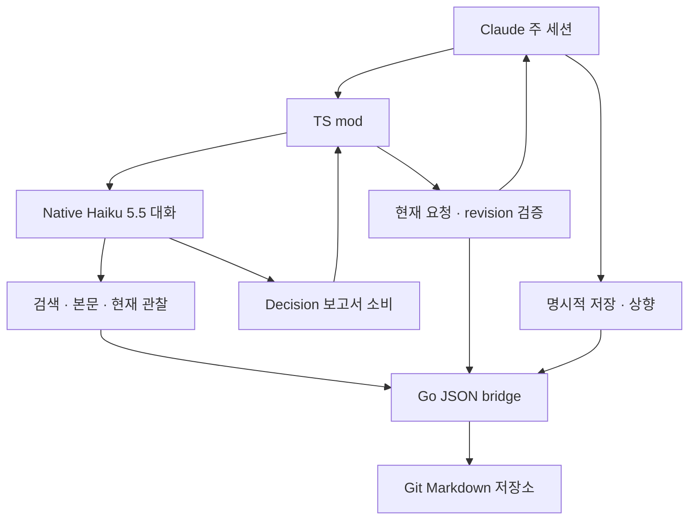

# Claude Code native memory mod

Ein / Sniffer v0.4.0의 Claude 연결은 **Claude Code가 관리하는 별도 native agent 대화**를 사용한다. TS mod가 주 세션의 관찰과 결과 전달을 조정하고, Go `sniffer bridge`가 프로젝트 범위·기억 파일·검색·Git 저장·중복 전달 이력을 처리한다. Claude 경로에 상주 Go HTTP worker나 `claude -p` 판단 프로세스는 없다.

## 먼저 알아둘 지원 범위

이 어댑터는 일반적인 shell hook만으로 동작하는 플러그인이 아니다. 설치한 Claude Code의 **function hook/mod API**에 다음 기능이 있어야 한다.

| 필요한 API | 사용하는 이유 |
|---|---|
| `$.agent.register`, `$.agent.spawn`, `$.agent.list` | 전용 agent 정의, 시작, 실제 host 소유권 확인 |
| `$.session.send({to:{agentId},text})` | 같은 child 대화에 후속 관찰 추가 |
| `agent.report` 및 `{consumed: ...}` | raw 보고서를 parent에 전달하기 전에 소비 |
| `prompt.submit`, `turn.start`, `turn.step`, `tool.call`, `tool.run` | 현재 요청 식별, 모델 확인, 도구 권한과 주입 경계 처리 |
| `session.compact`, `session.stop`, `turn.complete`, `session.end` | 취소, 압축, 세션 전환과 종료 처리 |
| `$.tool.register`, `$.tool.call` | reader/writer 도구 등록 및 소유한 background task 중지 |
| `$.process.run`, `$.session.messages`, `$.clock`, `$.env`, `$.fs.exists` | JSON bridge, 관찰, 시간 제한과 실행 파일 탐색 |

mod API는 early access다. 이 패키지는 확인하지 않은 최소 Claude 버전을 선언하지 않는다. 아래의 `claude plugin validate`와 **설치본이 생성한 타입 정의** 확인이 실제 연결의 전제다. 이 환경에서는 Claude CLI 로그인 세션을 실행하지 못했으므로 native host의 실동작 검증은 완료했다고 주장하지 않는다.

## 설치와 실행

Ein 통합 패키지가 mod를 함께 설치한다. [설치와 프로젝트 등록](../README.md)

```text
~/.ein/bin/sniffer
~/.ein/adapters/claude-mod/
~/.ein/memory/store/
```

등록된 실제 프로젝트 디렉터리에서 실행한다.

```sh
export PATH="$HOME/.ein/bin:$PATH"
claude plugin validate "$HOME/.ein/adapters/claude-mod"
claude --plugin-dir "$HOME/.ein/adapters/claude-mod"
```

직접 빌드한 파일을 사용할 때는 경로만 지정할 수 있다.

```sh
export EIN_SNIFFER_BIN="/absolute/path/to/sniffer"
claude --plugin-dir "/absolute/path/to/ein-sniffer/adapters/claude-mod"
```

기본 설치 루트를 옮겼다면 `EIN_HOME`을 절대 경로로 설정한다. 실행 파일은 `EIN_SNIFFER_BIN`, `${EIN_HOME}/bin/sniffer` 또는 기본 `~/.ein/bin/sniffer`, 마지막으로 PATH의 `sniffer` 순으로 찾는다. 주 세션과 Go bridge가 같은 `EIN_HOME`을 상속해야 한다. launcher token·HTTP endpoint·run ID 환경 변수는 Claude mod에 필요하지 않다.

기존 로그인은 Claude Code native agent가 그대로 사용한다. mod가 자격 증명 파일을 열거나 복사하는 방식은 아니다. 별도 API key나 별도 모델 제공자 설정을 요구하지 않는다. 모델 사용 자체에는 해당 계정의 이용 조건과 한도가 적용된다.

## 한 세션 안에서 일어나는 일



1. 세션이 시작되면 mod는 reader 3개와 writer 2개, private agent type을 등록한다. 이 agent type은 주 모델의 일반 위임 목록에서 숨긴다.
2. 사용자의 실제 프롬프트가 들어오면 Go `bridge begin`이 프로젝트와 요청 ID를 확정한다. mod는 현재 질문과 최근 주 대화·도구 결과의 제한된 관찰을 전달한다.
3. 첫 요청은 `$.agent.spawn`으로 시작한다. 정상적으로 응답을 마친 agent는 이후 `$.session.send`로 재사용한다. 따라서 같은 child ID와 그 child의 대화 이력이 이어진다.
4. child는 한국어·영어 검색어를 직접 정하고 필요하면 다시 검색한다. 검색 결과가 부족하면 다른 표현으로 검색할 수 있으며, `memory_read`의 `offset`/`limit`으로 본문 뒷부분도 읽을 수 있다. Go가 먼저 고정 후보 몇 개를 골라 그 안에서만 LLM을 판단시키는 방식은 아니다.
5. child는 `inject` 또는 `none`과 기억 ID·revision만 보고한다. mod는 `agent.report`의 host 검토를 거친 뒤 보고서를 소비한다. raw JSON이나 child가 생성한 임의 문장은 주 세션으로 자동 전달하지 않는다.
6. 다음 안전한 주입 지점에서 `bridge complete`가 프로젝트·요청·epoch·기억 revision을 다시 검사한다. 통과한 기억의 **저장된 본문**만 추가 context로 전달한다.
7. 전달된 context가 실제 hook 결과에 남아 있으면 `ack emitted`, 제거·취소·오류로 전달 여부를 확신할 수 없으면 `ack uncertain`을 기록한다. 이 ACK는 모델이 읽고 이해했다는 증명은 아니다.

주 세션이 Codex인지 Claude인지에 따라 서로 다른 제품의 인증을 섞지 않는다. 여기서는 `claude-haiku-5-5`, effort `medium`이 고정이다. 시작 결과와 각 child model step의 모델·effort를 검사하며 다른 모델로 조용히 바꾸지 않는다. 계정 또는 host 정책이 이를 지원하지 않으면 해당 회상을 사용하지 않고 주 세션을 계속 진행한다.

## 실제 주입 시점과 지연

`prompt.submit`에서 보고서가 준비될 기회를 기본 **1,000ms** 둔다. `EIN_SNIFFER_PROMPT_WAIT_MS`를 0~5,000의 정수로 지정하면 이 대기 예산을 바꿀 수 있다. 잘못된 값은 기본 1,000ms를 사용하고 0은 초기 대기를 생략한다. 이 시간 내에 준비되지 않은 결과는 다음 실제 **주 세션의 `tool.run` 결과 경계**를 기다린다. Go bridge의 각 로컬 작업에는 별도로 2.5초 실행 제한이 있다. 설정·디스크 작업과 host scheduling의 지연 때문에 전체 훅 시간이 정확히 이 대기 예산으로 고정된다는 의미는 아니다.

이 정책에는 명확한 한계가 있다. 도구 없이 바로 답변을 마치는 턴은 늦게 도착한 기억을 이용하지 못할 수 있다. 종료된 답변에 기억을 넣기 위해 가짜 user message나 새 답변 턴을 만들지 않는다. 턴이 끝났다면 진행 중인 회상을 취소하고, 다음 사용자 요청에서 다시 검색한다.

새 프롬프트가 기존 턴 뒤에 대기 중일 때는 그 새 프롬프트의 기억을 기존 턴의 도구 결과에 넣지 않는다. 실제 `turn.start`와 연결된 owner turn이 맞아야 도구 경계에서 주입한다.

## 읽기와 저장의 역할 분리

| 실행 주체 | 허용하는 Sniffer 도구 | 금지하거나 위임하지 않는 동작 |
|---|---|---|
| 전용 memory agent | `memory_search`, `memory_read`, `memory_context` | Bash, 일반 파일 읽기, 웹 검색, 다른 agent 생성, 저장, 상향 |
| 주 Claude 모델 | `memory_save`, `memory_promote` | memory-agent의 바인딩을 가장한 reader 호출 |
| 다른 child agent | 없음 | 주 모델 전용 writer 호출 |

reader 도구는 실제 agent ID와 현재 request ID에 묶인다. 이름이 비슷한 일반 subagent를 전용 agent라고 신뢰하지 않는다. 첫 child 이벤트가 spawn의 반환보다 먼저 도착하는 경우에도 Claude가 제공하는 `type`, `spawnedBy`, 고유 launch name을 확인한다.

writer는 **`tool.run` 단계**에서 구현했다. `tool.call`에서 writer를 바로 실행하면 host의 permission check를 건너뛸 수 있으므로 그렇게 하지 않는다. `isReadOnly` 표시만을 권한 검사로 간주하지도 않는다. TS가 모든 child의 writer 호출을 차단하고 Go bridge가 `role:main`, agent ID 부재와 프로젝트 바인딩을 다시 확인한다.

저장 도구의 입력은 다음과 같다. 저장 내용과 범위 결정은 주 모델의 명시적 요청으로 처리하며 회상 agent가 자동 저장하지 않는다.

```json
{
  "markdown": "---\nid: fictional-rule\ndescription: 가상 예시\n...\n---\n기억 본문",
  "if_revision": "new",
  "request_id": "a-stable-save-request-id"
}
```

위 Markdown은 필드 관계만 보이는 설명용 축약이다. 실제 유효 frontmatter는 샘플 기억과 [STORAGE.md](STORAGE.md)를 따른다. `memory_promote`는 `id`, `to`, `if_revision`, `request_id`, `apply`를 받는다. `apply:false`는 preview, `apply:true`는 전체 기억의 상향 적용이다. 부분 내용의 상향은 별도 CLI 절차를 사용한다.

## 관찰과 생명주기

주 세션 전체 기록을 매번 복사하지 않는다. 최근 메시지 최대 12개를 참고하고, 대화 내용에는 16,000 UTF-8 byte, 최근 도구 관찰에는 7,500 byte 예산을 둔다. 현재 질문은 8,192 byte로 제한하며, 잘린 입력에는 표시를 남긴다. 최근 내용을 먼저 보존한다. child의 native 대화에는 이전 요청의 관찰과 검색 경험이 쌓이지만, 새로운 요청에서 선택할 기억의 revision은 다시 읽도록 지시한다.

| 상황 | 처리 |
|---|---|
| 정상 report 완료 후 다음 질문 | 같은 native child에 새 관찰을 send |
| 아직 검색 중인데 새 질문 도착 | 이전 요청 취소, 이전 child 은퇴, 새 child 시작 |
| main turn 완료 또는 Stop | 아직 실행 중인 child 취소; 이미 응답한 child는 다음 질문에서 재사용 가능 |
| 성공한 main compaction | epoch 초기화, 이전 child 은퇴, 다음 질문에서 새 child |
| `/clear`, resume/branch 전환, 세션 종료 | 기존 바인딩과 큐 무효화, 해당 child 정리 |
| mod reload | 이전 child를 새 요청에 임의 재연결하지 않고 은퇴 처리 |
| 한 회상이 45초 초과 | 해당 child 은퇴와 요청 취소 |
| TaskStop 실패 또는 늦은 report | 은퇴 ID를 계속 보관하여 도구 차단·report 소비 |

TaskStop은 mod가 시작한 agent ID만 대상으로 한다. 다른 subagent나 주 세션 전체를 중지하지 않는다. CLI 프로세스 종료에 따른 native child의 최종 정리는 Claude host의 생명주기에도 의존한다. Go bridge 프로세스는 각 JSON 작업이 끝나면 종료된다.

## 검증 결과와 직접 확인할 항목

2026-11-26 기준, `register.test.mjs`의 **21개 Node 계약 테스트**가 통과했다. 전용 모델·도구 제한, native 대화 재사용, 한국어/영어 재검색과 본문 paging, main-only writer와 host permission 순서, raw report 소비, safe handoff 및 uncertain ACK, 오래된 결과·새 프롬프트·압축·종료·timeout·잘못된 모델·UTF-8 예산·대기 설정·실패한 bridge 등을 검증한다.

```sh
node --test adapters/claude-mod/hooks/register.test.mjs
```

개발용 Node는 TypeScript type stripping을 지원해야 한다. 실제 mod runtime에는 Node나 npm 라이브러리를 로드하지 않는다. 테스트 파일의 `node:test`와 타이머는 테스트 harness 전용이다.

공식 저장소의 현재 `claude-code.d.ts`를 대상으로 TypeScript의 `strict`, `noUncheckedIndexedAccess`, `lib:ES2023` 설정으로 검사했다. vendor API 선언을 제품에 복제해 넣지는 않는다. 이 검사는 실제 로그인된 Claude 세션, 설치본 mod validator, Haiku 5.5의 계정별 사용 가능 여부 또는 실제 응답 품질을 검증한 결과와 구분해야 한다.

설치한 CLI에서 확인할 순서는 다음과 같다.

1. `claude plugin validate`가 mod의 API 호출과 문법을 허용하는지 확인한다.
2. Claude가 생성하는 `.claude-plugin/types/`의 선언과 현재 TypeScript를 대조한다. 특히 `agent.report`와 `consumed`가 없으면 설치를 진행하지 않는다.
3. 가상 기억이 있는 등록 프로젝트에서 회상하고, 같은 세션의 다음 질문이 기존 child ID를 사용하는지 확인한다.
4. 저장을 직접 요청하여 main writer가 host permission 절차를 따르는지 확인한다.
5. Stop·새 프롬프트·압축 뒤 늦은 기억이 추가되지 않는지 확인한다.

## 공식 API 근거

- [Claude Code mods API](https://code.claude.com/docs/en/plugins/mods/api)
- [Mod 작성과 runtime 제약](https://code.claude.com/docs/en/plugins/mods/create)
- [Mods reference](https://code.claude.com/docs/en/plugins/mods/reference)
- [공식 현재 TypeScript API 선언](https://github.com/anthropics/claude-code/blob/main/mods/types/claude-code.d.ts)
- [Agent SDK built-in TaskStop 입력](https://code.claude.com/docs/en/agent-sdk/typescript#taskstop)

이 모듈과 Go bridge는 독립적으로 작성했다. Kibitzer의 원본 구현이나 라이선스된 코드를 복제하지 않는다.
