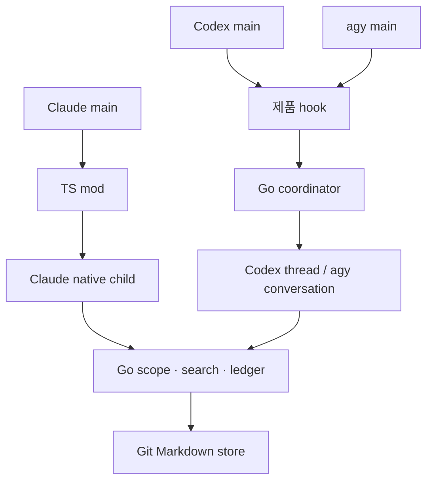

# CLI 연결과 native memory agent

Ein / Sniffer v0.4.0은 **제품마다 대화를 유지하는 memory agent**와 공통 Go 저장·검색 코어를 연결한다. 일반적으로 요청이 끝나도 memory agent 대화는 유지하며, 다음 요청에서 같은 대화에 관찰을 추가한다. 자동 회상은 읽기 전용이고, 저장·상향은 주 모델의 별도 명시적 요청으로 처리한다.

기억 저장소는 `~/.ein/memory/store/`다. 설정은 `~/.ein/config.json`, 전달 이력과 현재 요청 상태는 `~/.ein/memory/state/`, 실행 중 임시 파일은 `~/.ein/run/`에 둔다. `EIN_HOME`으로 이 공통 루트를 옮길 수 있다. 대상은 CLI이며 GUI 연결은 포함하지 않는다.

## 1. 제품별로 다른 연결부

| 주 세션 | memory agent 대화 | 실행·연결 주체 | main에 전달하는 경계 | 고정 모델 설정 |
|---|---|---|---|---|
| Claude Code CLI | 같은 Claude host가 관리하는 native child agent | TS mod의 `agent.register/spawn` 및 `session.send` | `prompt.submit`의 context, 실제 main `tool.run` 결과의 context | `claude-haiku-5-5`, effort `medium` |
| Codex CLI | 별도 `codex app-server`의 persistent thread | launcher 소유 Go coordinator와 JSON-RPC | `UserPromptSubmit`, `PreToolUse`, `PostToolUse`의 `additionalContext` | `gpt-6-luna`, reasoning `low`, service tier `fast` |
| Antigravity CLI (`agy`) | stdin을 열어 둔 headless streaming conversation | launcher 소유 Go coordinator와 stream JSON | `PreInvocation`의 `injectSteps` | `gemini-4-hydrogen-low` |

Claude 연결에는 Go HTTP worker가 필요하지 않다. Claude memory agent의 모델 실행은 Claude가 직접 맡고, TS는 짧은 `sniffer bridge` 작업으로 Go 코어를 이용한다. Codex·agy는 각각 native 대화 프로토콜을 Go가 관리하므로 launcher에 속한 coordinator가 상주한다. 어느 제품도 회상마다 새로운 `claude -p` 또는 `codex exec`로 판단기를 만드는 방식이 아니다. [C1][C2][X1][A2]

MCP가 맡는 범위도 구분한다. Claude는 mod 도구, Codex는 app-server 동적 도구로 검색하므로 memory agent의 reader 경로에 별도 MCP 서버가 없다. agy는 자체 memory conversation 안에 private read-only MCP를 연결한다. 세 제품의 **main 모델이 명시적으로 저장**할 때 쓰는 선택적 writer MCP는 별도 인터페이스다.



도표는 회상 호출의 관계다. 주 모델의 writer 요청은 같은 Go 코어를 통해 별도의 저장·상향 검증과 Git commit을 거친다.

## 2. 공통 설치와 준비 확인

Ein 통합 설치로 실행 파일, 어댑터와 기억 저장소를 준비한다. 프로젝트 디렉터리에서 실행하면 등록된 project/group/global 계층으로 검색 범위를 결정한다. [설치와 프로젝트 등록](../README.md)

```sh
sniffer doctor --host claude
sniffer doctor --host codex
sniffer doctor --host agy
```

CLI가 PATH에 없거나 다른 설치본을 사용할 때는 다음과 같이 경로를 지정한다.

```sh
sniffer doctor --host codex --executable /absolute/path/to/codex
sniffer doctor --host codex --executable /absolute/path/to/codex --configure
```

`--configure`는 로컬 capability 확인이 통과한 실행 파일 경로를 Sniffer 설정에 저장한다. `doctor`는 `--version`/`--help`와 필요한 명령·플래그를 확인한다. Claude는 mod 설치 여부도 확인한다. **로그인, 모델 entitlement, 실제 검색, native 프로토콜 전체 호환성, hook 승인까지 완료했다는 뜻은 아니다.** 출력의 `live_model_tested`는 `false`이며, native memory conversation 시작 때 추가 정책·프로토콜 검사가 수행된다. 이전 버전의 `--verify-judge` 또는 fingerprint 승인 절차는 없다.

## 3. Claude Code: native mod

### 실행

설치한 mod를 먼저 검증한다.

```sh
claude plugin validate "$HOME/.ein/adapters/claude-mod"
sniffer run claude
```

`sniffer run claude`는 설치된 mod 경로를 `--plugin-dir`로 전달하고, `EIN_HOME`과 Sniffer 실행 파일 위치를 지정한다. Go HTTP coordinator를 띄우지 않는다. 직접 실행도 가능하다.

```sh
export PATH="$HOME/.ein/bin:$PATH"
claude --plugin-dir "$HOME/.ein/adapters/claude-mod"
```

정확한 최소 CLI 버전을 추측해 manifest에 고정하지 않았다. 설치한 Claude의 mod API에 `agent.report`와 `consumed`, native `agent.register/spawn`, `session.send`, `tool.run` 등이 있어야 한다. 설치본이 생성한 `.claude-plugin/types/`와 `claude plugin validate` 결과를 기준으로 확인한다. 일반 shell hook 지원만으로는 이 어댑터를 실행할 수 없다. [C1][C2][C3]

### native 대화와 주입

TS mod는 세션별 private agent를 Haiku 5.5 / medium으로 시작한다. agent가 정상 응답을 마치면 같은 ID에 `session.send`로 새 관찰을 추가한다. 주 세션의 최신 질문, 최근 대화와 도구 결과를 제한된 크기로 전달하고, child는 자신의 검색어를 정해 `memory_search`, `memory_read`, `memory_context`를 호출한다. 최초 후보 몇 개 안에서만 선택하도록 제한하지 않는다.

`agent.report`는 parent에 자동 전달되기 전에 소비한다. child는 `decision`, 최대 3개의 `{id,revision}`, `reason`만 반환한다. TS는 그 Decision을 큐에 보관하고, 실제 주입 직전에 Go `bridge complete`로 현재 요청·scope·epoch·revision을 다시 확인한다. 주 세션에 들어가는 내용은 Go가 읽은 canonical 저장 본문이다.

초기 대기 예산은 기본 1,000ms이며 `EIN_SNIFFER_PROMPT_WAIT_MS`의 0~5,000 정수로 조정할 수 있다. 그 뒤 도착한 결과는 다음 실제 main 도구 결과 경계를 기다린다. 도구 없이 끝나는 턴의 늦은 기억까지 보장하지 않으며, 기억 전달만을 위해 새 user turn을 만들지 않는다.

읽기 도구는 private agent만 사용할 수 있다. `memory_save`·`memory_promote`는 main 모델만 사용할 수 있고, host permission check 이후의 `tool.run`에서 실행한다. 일반 child도 writer를 사용할 수 없다. 명령 실행, 웹 검색, 다른 agent 생성은 memory agent에게 열지 않는다.

### 생명주기와 인증

새 질문이 왔는데 이전 child가 아직 실행 중이면 이전 요청을 취소하고 그 child를 은퇴시킨다. 늦은 보고서는 소비하고, 은퇴 ID의 도구는 계속 차단한다. main Stop·진행 중인 턴 종료·성공한 압축·세션 종료에도 해당 상태를 정리한다. 정상 완료한 idle child는 다음 질문에서 재사용하지만 압축·reload·세션 전환 후 대화 연속성은 새 child에서 시작한다.

native child는 main Claude host의 기존 인증을 사용한다. TS가 credential 파일을 읽거나 복사하지 않는다. Node `fs`, `child_process`, npm 라이브러리를 mod runtime에 로드하지 않고 공식 `$` API만 쓴다. detailed API 계약·실패 처리·모의 테스트는 [CLAUDE-MOD.md](CLAUDE-MOD.md)에 정리했다.

## 4. Codex: command hooks와 app-server thread

### hook 설치와 실행

`sh install.sh --with-hooks`는 `adapters/codex/hooks.example.json`의 명령을 설치 경로에 맞춰 사용자 수준 `$CODEX_HOME/hooks.json`(기본 `~/.codex/hooks.json`)에 병합한다. 기본 설치로 시작한 경우 `sniffer install-hooks`로 연결할 수 있다. Codex의 hook 신뢰 확인은 제품에서 진행한다. [X1]

```sh
sniffer doctor --host codex
sniffer run codex
```

`--` 뒤에는 기존 main CLI 인자를 전달할 수 있다.

```sh
sniffer run codex -- --model YOUR_MAIN_MODEL
```

위 main 모델 선택은 memory agent의 고정 GPT-6 Luna / Fast / low 설정을 변경하지 않는다.

### 유지되는 thread

Go coordinator는 필요할 때 `codex app-server --stdio --no-daemon`을 시작한다. `initialize`에서 experimental API를 활성화하고, 하나의 `thread/start`로 private memory thread를 만든 뒤 관찰마다 같은 thread의 `turn/start`를 보낸다. `codex exec`를 반복 실행하지 않는다. [X2]

thread와 turn 요청은 `gpt-6-luna`, `low`, `serviceTier:fast`를 고정한다. 여기서 Fast 설정의 실제 protocol 값은 `fast`이며 `priority`로 치환하지 않는다. adapter는 host가 보고하는 유효 model/provider, reasoning effort, service tier, sandbox, cwd와 approval 설정을 검사하고 예상과 다른 설정을 받아들이지 않는다.

memory thread의 동적 도구는 `memory_search`, `memory_read`, `memory_context` 세 개다. 각 도구 호출을 현재 요청과 연결해 Go reader로 처리한다. memory agent는 다른 검색어로 재검색하거나 body를 paging할 수 있다. provider가 반환한 도구 결과와 대화 문맥은 다음 정상 관찰에서도 같은 thread에 남는다.

### 권한과 observation 범위

memory thread는 read-only sandbox, approval `never`, 네트워크 비활성화 조건으로 시작한다. shell·app·plugin·hook·browser·추가 agent·다른 MCP 등 불필요한 기능을 제한한다. 인증 설정은 그대로 유지하되 `config/read`에서는 연결된 MCP 이름을 확인해 해당 서버를 비활성화한다. 예상치 못한 native 도구 호출이 나타나면 실패 처리한다. 이 사후 감시는 sandbox와 사전 capability 제한을 대체하지 않는다. [X2][X3]

main `UserPromptSubmit`은 질문을, `PreToolUse`와 `PostToolUse`는 관찰을 보낸다. 관찰은 도구 이름, 허용한 경로·검색 메타데이터와 완료된 도구의 제한된 텍스트 결과를 포함한다. arbitrary shell command나 작성 예정 파일 전체를 복사하지 않는다. 텍스트 발췌에는 알려진 credential 패턴의 best-effort 가림 처리가 있지만 모든 자유 텍스트 비밀을 식별한다는 보장은 아니다.

주입 출력은 `hookSpecificOutput.additionalContext`다. 예제는 이 context를 반환하는 handler에 `additionalContextLimit:0`을 지정한다. Go가 기본 12 KiB, 설정상 최대 32 KiB로 출력 전체를 먼저 제한하므로 제품의 기본 spill이 reference JSON을 중간에서 자르는 일을 피하기 위한 설정이다. 이 값은 Sniffer handler에만 적용한다. [X1] `PreModelRequest`와 `PostModelRequest`를 주입 지점으로 사용하지 않는다. `SessionStart`의 `source:compact`에서만 문맥 epoch를 변경한다. hook에 event ID가 없으면 개별 실행 ID를 만들며, 같은 사용자가 같은 문장을 다시 썼다고 이전 이벤트와 같은 것으로 취급하지 않는다.

### 취소와 재연결

정상적으로 끝난 memory turn 뒤에는 app-server와 thread를 유지한다. 취소·프로토콜 오류·정책 불일치 때는 소유한 process group을 종료하고 다음 요청에서 새 native session을 만든다. coordinator는 이것이 **새 대화**임을 명시하며 제한된 main 관찰 history로 다시 시작한다. 이전 LLM의 reasoning이나 도구 이력이 온전히 복원되었다고 가장하지 않는다.

로그인은 CLI의 기존 환경과 `CODEX_HOME`을 상속해 제품 자체 인증 로더가 사용한다. main 프로세스 메모리에만 존재하는 자격 증명이 별도 app-server 프로세스로 자동 전달된다고 가정하지 않는다. 일반적인 지속 로그인 상태의 실제 사용 가능 여부는 사용자 설치 환경에서 확인해야 한다. [X4]

## 5. Antigravity CLI: persistent stream과 private reader MCP

### hook 설치와 실행

대상 실행 파일은 `agy`다. `sh install.sh --with-hooks` 또는 `sniffer install-hooks`는 `adapters/antigravity/hooks.example.json`의 `sniffer-memory` 그룹을 사용자 `~/.gemini/config/hooks.json`에 병합하고 Sniffer 절대 경로를 지정한다. [A1]

```sh
sniffer doctor --host agy
sniffer run agy
```

예제는 `sniffer hook agy --event PreInvocation`처럼 hook 이름을 명시한다. payload에 항상 이벤트명 필드가 있다고 추측하지 않는다. 실제 프로젝트 바인딩에는 `workspacePaths`를 사용한다. 서로 다른 프로젝트가 한 workspace에 섞였을 때 자동으로 기억을 합치지 않는다.

### memory conversation 실행

adapter는 private runtime directory를 cwd로 삼아 다음 형태로 시작한다. schema 경로 등은 Sniffer가 생성한다.

```sh
agy --input-format stream-json --output-format stream-json \
  --model gemini-4-hydrogen-low \
  --agent sniffer-memory-agent \
  --json-schema /private/runtime/decision.schema.json \
  --disable-slash-commands --mode plan
```

`low`는 고정 모델 slug에 포함되며 별도의 확인되지 않은 effort 플래그를 붙이지 않는다. stdin을 유지하고 한 요청의 result를 받은 뒤 다음 관찰을 보낸다. 정상 경로는 같은 process와 conversation ID를 유지한다. [A2]

runtime에는 `.agents/agents/sniffer-memory-agent.md`, `.agents/mcp_config.json`, `.agents/hooks.json`, 현재 `context.json`과 decision schema를 만든다. 디렉터리는 사용자 전용 권한으로, 파일은 0600으로 생성한다. private MCP는 다음 역할로 연결한다.

```sh
sniffer --home /absolute/ein-home mcp \
  --role agent-reader --project REGISTERED_PROJECT_ID \
  --context-file /private/runtime/context.json
```

agent-reader는 `memory_search`, `memory_read`, `memory_context`만 제공한다. 모델에게는 agy가 붙인 `mcp_sniffer_memory_*` 이름으로 나타난다. `.agents/hooks.json`의 `PreToolUse:*` guard는 이 세 reader만 허용한다. 저장·상향·명령·위임·외부 MCP는 허용하지 않는다. `send_message`·`ask_permission` 같은 native control tool이 inventory에 나타날 수 있지만 guard는 실행을 거절한다.

### customization과 실제 경계

agent 정의의 `tools:[]`, `commandExecutionPolicy:off`, `skills:[]`, `plugins:[]`만으로 운영체제 격리가 완성된다고 주장하지 않는다. workspace의 자체 guard를 로드하려면 `inheritCustomizations:true`가 필요하다. 문서화된 per-process 전역 customization 전체 차단 옵션을 확인하지 못했으므로, 기존 사용자/global customization이 로드될 수 있다.

Sniffer는 입력을 보내기 전에 init의 model·agent·mode와 tool inventory를 확인하고 추가 capability가 있으면 회상을 거절한다. 이 검사는 agy 실행 파일이나 사용자가 설치한 hook 프로그램 자체를 OS sandbox에 넣는 기능이 아니다. 설치본에서 `PreToolUse` guard가 실제로 적용되는지 별도 live 검증이 필요하다. 자세한 정책은 `adapters/antigravity/sniffer-memory-agent.md`에 포함했다. [A3]

### 주입과 종료

main hook의 주입은 `PreInvocation`의 `injectSteps[].systemMessage.systemMessage`다. `PostToolUse`는 관찰을 갱신한다. 문서화된 agy payload는 도구 결과 전체를 제공하지 않으므로 도구 이름·허용 인자·오류 텍스트만 사용하며, `transcriptPath`를 열어 부족한 결과를 임의로 수집하지 않는다. [A1]

Stop은 현재 회상 취소이며 main CLI 종료와 동일하지 않다. streaming 프로토콜의 임의 interrupt 메시지를 만들어 보내지 않는다. 취소 시 소유한 headless process group을 정리하고 다음 요청에서 새 conversation을 만든다. 복구 시 제한된 관찰 seed가 새 대화라는 표시와 함께 들어가며, 누락된 이전 관찰이나 모델 내부 추론을 복원한 것처럼 표현하지 않는다. 확인되지 않은 압축 이벤트를 가정하지도 않는다.

agy는 기존 사용자 계정과 제품 로그인 환경을 사용한다. Sniffer는 credential/keyring 파일을 읽거나 바꾸지 않는다. [A4]

## 6. coordinator 활성화와 저장 요청

다음 환경 변수는 **Codex·agy의 launcher 경로**에 적용된다. Claude native mod의 활성화 조건과 혼동하지 않는다.

| 환경 변수 | 역할 |
|---|---|
| `EIN_HOME` | 설정·기억·상태·adapter의 공통 루트 |
| `EIN_SNIFFER_RUN_ID` | 해당 launcher 실행의 식별자 |
| `EIN_SNIFFER_ENDPOINT` | `127.0.0.1`의 임시 coordinator 주소 |
| `EIN_SNIFFER_TOKEN_FILE` | 사용자 전용 run token 경로 |
| `EIN_SNIFFER_HOST`, `EIN_SNIFFER_PROJECT_ID` | 해당 실행의 제품·프로젝트 바인딩 |
| `EIN_SNIFFER_BIN` | Sniffer 실행 파일 절대 경로 |
| `EIN_SNIFFER_ROLE=memory-agent` | child에서 일반 hook 재귀와 writer 실행 차단 |

launcher가 없는 일반 Codex·agy 실행은 전역 hook이 설치되어 있어도 이 자동 회상 경로를 활성화하지 않는다. 토큰이나 인증 파일을 기억 저장소에 넣지 않는다. coordinator의 로컬 HTTP 인터페이스는 저장 writer API를 제공하지 않는다.

Claude main은 mod writer 도구를 쓸 수 있다. Codex·agy main은 명시적 Sniffer CLI 명령 또는 **별도로 설정한** `sniffer mcp --role writer --project ...`를 이용한다. main 모델에는 필요에 따라 reader와 writer MCP를 함께 연결할 수 있다. private memory agent에는 reader만 연결하며 writer를 주지 않는다. `--role agent-reader`는 agy 내부의 현재 요청 파일에 묶인 경로이며 일반 writer 대용이 아니다.

writer의 저장은 `markdown`, `if_revision`, `request_id`를 받고, 상향은 `id`, `to`, `if_revision`, `request_id`, `apply`를 받는다. 상향의 `apply:false`는 검토용 preview, `apply:true`는 명시적 적용이다. 저장할 내용의 의미 판단과 사용자 요청 해석은 main LLM이 담당한다. Go는 scope, revision, 입력 형식, 중복 요청, Git transaction을 검증한다.

이 역할 분리는 신뢰하는 로컬 CLI·mod와 해당 제품의 실행 정책을 전제로 한다. 같은 macOS 사용자 권한을 가진 악성 프로그램끼리 완전히 격리하는 경계는 아니다.

## 7. 검색·중복 전달·지연의 공통 계약

memory agent는 검색어를 직접 선택하고 한영 대안을 시도할 수 있다. `memory_read`는 offset/limit으로 본문을 읽는다. query와 관찰은 요청별 크기·시간·도구 호출 예산으로 제한된다. 과거 대화에서 읽은 기억도 선택하기 전에 현재 revision을 다시 읽어야 한다.

최종 결과는 다음 JSON 계약이다.

```json
{
  "decision": "inject",
  "references": [{"id": "fictional-rule", "revision": "1111111111111111111111111111111111111111"}],
  "reason": "현재 질문과 관련된 기억"
}
```

`none`이면 references는 빈 배열이다. Go는 여분 필드·중복 reference·존재하지 않는 ID·잘못된 revision·현재 scope 밖의 기억을 거절한다. reason은 저장하거나 본문처럼 주입하지 않는다. 최종 기억은 저장소에서 다시 읽은 canonical text이며 prompt/메모리 본문에 적힌 임의 지시를 실행 권한으로 해석하지 않는다.

전달 이력은 제품, main conversation, 프로젝트, context epoch와 memory ID/content hash에 연결된다. 검색 자체는 전달 완료로 기록하지 않는다. 실제 context를 내보내는 경계에서 claim하고 그 뒤 ACK를 남긴다. command hook의 stdout 성공이나 mod context handoff는 모델의 이해를 확인하는 신호가 아니므로 exactly-once 의미 전달을 주장하지 않는다. 오류로 전달 여부가 불확실하면 보수적으로 uncertain을 기록한다.

Codex·agy coordinator의 초기 대기는 기본 1,000ms이며 설정의 `recall.wait_millis`로 0~5,000ms 범위에서 바꿀 수 있다. 실행 제한은 기본 60초다. Claude의 초기 대기는 별도 mod 환경 변수, 실행 제한은 45초다. 모든 경로에서 유한 대기 이후 늦은 기억은 다음 실제 주입 경계에만 들어간다. main 턴이 먼저 끝나면 회상을 취소한다.

외부 벡터 DB나 유료 기억 저장 서비스는 없다. 모델 호출은 각 제품의 기존 계정·요금제·사용 한도를 따른다. 메모리 backend가 로컬이라는 사실이 LLM 사용량까지 항상 무료라는 뜻은 아니다.

## 8. 검증 결과를 읽는 법

| 검증 | 확인하는 내용 | 이번 구현의 범위 |
|---|---|---|
| Go 단위·통합 및 가상 제품 프로토콜 | scope, Git writer, revision, ledger, 프로토콜 상태, 시간 제한과 프로세스 정리 | Go 테스트에 포함 |
| Claude Node 계약 테스트 | native agent 재사용, 권한·보고서·주입·ACK·lifecycle·대기 설정 | 21개 통과 |
| Claude 공식 d.ts 정적 검사 | 현재 공식 함수형 mod API의 TypeScript 형식과 runtime lib 제약 | strict/noUncheckedIndexedAccess/ES2023 검사 통과 |
| 제품 CLI의 실제 mod/hook 승인·로딩 | 사용자 설치 버전과 정책에 따른 런타임 동작 | 실 로그인 환경에서 별도 확인 필요 |
| 실제 고정 모델 호출 | 계정 인증, 모델 접근, 실제 relevance와 비용 | 이번 패키지에서는 호출하지 않음 |
| macOS native sandbox·Keychain·interactive lifetime | Mac에서의 실제 제품 조합 | Linux 개발 환경 테스트와 구분하여 확인 필요 |

```sh
go test ./...
node --test adapters/claude-mod/hooks/register.test.mjs
```

live 검증에는 먼저 가상의 샘플 기억을 사용한다. 같은 세션의 후속 질문에서 native 대화 ID가 이어지는지, 다른 프로젝트 기억이 제외되는지, 같은 revision이 반복 주입되지 않는지, 취소·압축·새 질문 뒤 늦은 결과가 무시되는지 확인한다. mock 통과를 세 제품의 실제 Mac 통합 시험 완료로 기록하지 않는다.

## 공식 자료

확인 기준: 2026-11-26. 구현은 독립적으로 작성했다. 제품 API는 바뀔 수 있으므로 설치 CLI의 도움말, 생성된 타입과 runtime 응답을 함께 확인한다.

- [C1] [Claude mods API](https://code.claude.com/docs/en/plugins/mods/api)
- [C2] [Claude 공식 mod TypeScript 선언](https://github.com/anthropics/claude-code/blob/main/mods/types/claude-code.d.ts)
- [C3] [Create a Claude mod](https://code.claude.com/docs/en/plugins/mods/create)
- [X1] [Codex hooks](https://learn.chatgpt.com/docs/hooks)
- [X2] [Codex app-server](https://developers.openai.com/codex/app-server/)
- [X3] [Codex configuration reference](https://learn.chatgpt.com/docs/config-file/config-reference)
- [X4] [Codex authentication](https://learn.chatgpt.com/docs/auth)
- [A1] [Antigravity hooks](https://antigravity.google/docs/hooks)
- [A2] [Antigravity headless mode](https://antigravity.google/docs/cli/headless/)
- [A3] [Antigravity custom subagents](https://antigravity.google/docs/subagents)
- [A4] [Antigravity authentication](https://antigravity.google/docs/authentication)
