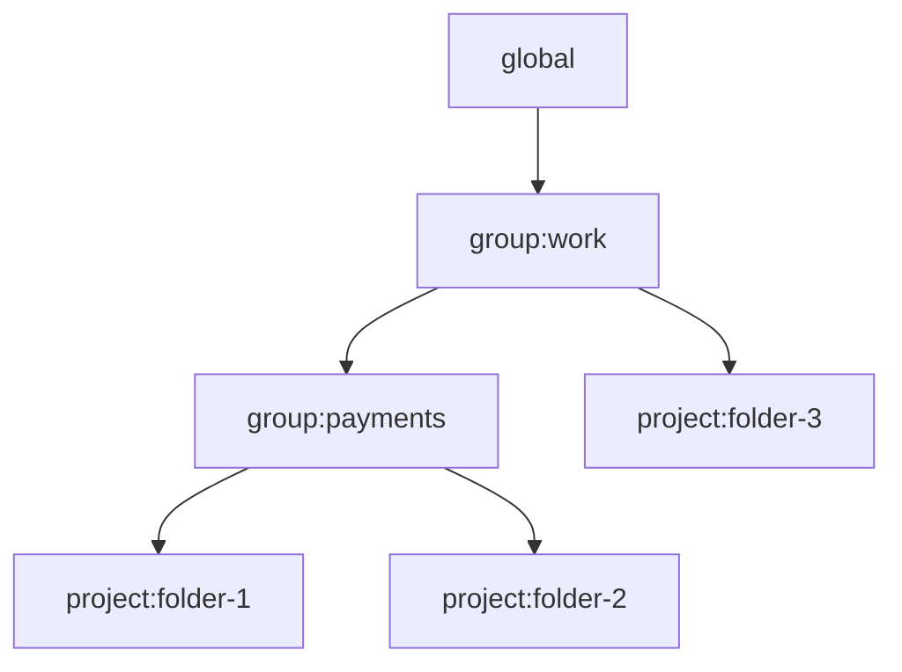

# 저장소·범위·트랜잭션 검토 문서

이 문서는 Go 엔진의 저장 형식과 검색·복구 동작을 설명한다. [설치와 사용법](../README.md) · [호스트별 연결](INTEGRATIONS.md)

## 1. 물리 경로와 논리 범위

기본 Sniffer 루트는 `~/.ein/`이다. 장기 기억은 **`~/.ein/memory/store/` 한 곳**에서 관리한다. 프로젝트 폴더에는 기억 저장소를 만들지 않는다.

| 경로 | 내용 | 기억 Git에 포함 |
| --- | --- | --- |
| `memory/store/.ein-store.json` | Sniffer 전용 저장소 식별 marker | 예 |
| `memory/store/scopes.json` | global, group, project의 부모 관계 | 예 |
| `memory/store/glossary.json` | 한영 검색 대응어 묶음 | 예 |
| `memory/store/global/<id>.md` | 공통 기억 | 예 |
| `memory/store/groups/<slug>/<id>.md` | 특정 상위 그룹의 기억 | 예 |
| `memory/store/projects/<slug>/<id>.md` | 프로젝트 전용 기억 | 예 |
| `memory/state/store.lock` | 프로세스 간 writer 잠금 | 아니요 |
| `memory/state/transactions/<request-hash>.json` | 저장·승격 복구 journal | 아니요 |
| `config.json` | 실제 프로젝트 경로와 고정 ID 연결 | 아니요 |
| `run/` | 실행 중 worker·세션 연결 정보 | 아니요 |

`state`가 저장소 안에 들어가는 설정은 거부한다. 기존 경로의 symlink를 해석한 결과도 검사하므로 다른 경로 이름으로 저장소 내부를 state로 지정할 수 없다. Mac의 상위 시스템 경로가 정규화되는 경우는 허용하되, 실제 store/state 디렉터리 자체와 작업 대상 경로의 symlink는 허용하지 않는다.

샘플의 논리 계층은 다음과 같다. 디렉터리의 OS 부모를 따라 자동 공유하지 않고, `scopes.json`의 명시적 관계만 사용한다.



folder-1은 자기 기억, payments, work, global을 이 순서로 읽는다. folder-2도 같은 상위 기억을 읽지만 folder-1의 전용 기억은 읽지 않는다. folder-3은 work와 global을 읽고 payments에는 접근하지 않는다. 이 구분은 Sniffer 조회 범위이며 같은 Mac 사용자 계정의 파일 접근을 격리하는 운영체제 보안 경계는 아니다.

## 2. 독립 Git 저장소 초기화

`sniffer memory init`은 새 비어 있는 디렉터리에 독립 Git 저장소를 초기화한다. 이미 초기화된 유효한 Sniffer 저장소에서는 추가 commit 없이 성공한다. 다음 경우에는 초기화를 거부한다.

- Sniffer 저장소가 아닌 비어 있지 않은 디렉터리
- 다른 Git 저장소 내부의 새 하위 디렉터리
- 자체 `.git` 디렉터리를 갖지 않는 worktree·상위 저장소 종속 경로
- committed marker, scope registry, 기억 경로가 유효하지 않은 저장소

초기 commit에는 전용 marker, global scope, 한영 glossary만 들어간다. 애플리케이션 저장소를 수정하거나 remote를 등록하지 않는다. Git 호출은 로컬 객체·인덱스·ref 작업만 수행하며 push, fetch, pull을 호출하지 않는다. 별도 Git 사용자 설정을 요구하지 않도록 이 저장소 작업에만 Sniffer 작성자를 지정한다. 실행 시 Git hooks, commit signing, fsmonitor, 외부 attributes와 사용자·시스템 Git 설정의 영향을 제한한다.

## 3. 기억 문서 형식

다음 내용은 가상 예제다.

```yaml
---
schema_version: 1
id: m-local-port
scope_id: project:folder-1
description: "가상 folder-1의 로컬 서버 포트는 4317이다"
key: folder1.server.port
aliases: ["로컬 포트", "local port", "PORT"]
tags: ["fictional", "configuration"]
updated_at: "2026-11-25T00:00:00Z"
---
# 가상 로컬 설정
folder-1의 개발 서버 기본 포트는 4317이다.
```

본문은 Markdown이며 필수다. YAML frontmatter의 허용 필드와 타입은 아래와 같다.

| 필드 | 필수 | 검증·의미 |
| --- | --- | --- |
| `schema_version` | 예 | 정수 `1` |
| `id` | 예 | 소문자 ASCII 슬러그, 최대 64자; 저장소 전체에서 유일 |
| `scope_id` | 예 | `global`, `group:<slug>`, `project:<slug>`; registry에 등록되어 있어야 함 |
| `description` | 예 | 비어 있지 않은 문자열; 최대 2,048 bytes |
| `key` | 아니요 | 의미상 규칙 이름; 최대 256 bytes |
| `aliases` | 아니요 | 문자열 배열; 최대 32개, 항목당 최대 256 bytes |
| `tags` | 아니요 | 문자열 배열; 최대 32개, 항목당 최대 256 bytes |
| `updated_at` | 아니요 | RFC 3339 시각 문자열 |
| `derived_from` | 아니요 | 원본 `id`와 Git blob `revision`의 객체 |

전체 입력은 최대 96 KiB, frontmatter는 최대 16 KiB, 정규화된 본문은 최대 64 KiB다. ID는 `[a-z0-9][a-z0-9_-]{0,63}` 형식을 쓴다. description·body·key는 Unicode NFC와 LF 줄바꿈을 기준으로 다룬다.

유지 관리되는 YAML 라이브러리를 사용하되 이 프로토타입의 제한된 스키마만 허용한다. 중복 키, 알 수 없는 필드, 숫자로 된 description, 복잡한 객체 태그, anchors, YAML aliases, 여러 YAML 문서는 거부한다. 검색용 **`aliases` 문자열 필드**와 YAML 문법의 **alias 참조**는 서로 다른 개념이다. 검색용 aliases는 지원한다.

문서 경로는 `scope_id`와 `id`에서 계산한 경로와 정확히 같아야 한다. `../`, 절대 경로, 역슬래시, 잘못된 슬러그, 중복 ID, scope 불일치, symlink·gitlink·실행 파일 모드의 committed 항목을 거부한다. registry와 glossary JSON에서도 중복 키와 잘못된 구조를 거부한다. provenance는 대상 원본 ID가 저장소에 존재하고 지정한 Git blob이 그 ID의 유효한 기억 문서인지 검사한다. 전체 과거 provenance 그래프의 역사적 진실성을 외부 근거로 증명하는 기능은 아니다.

## 4. 검색은 committed HEAD만 읽는다

`Snapshot`은 시작할 때 `HEAD` commit 하나를 고정한다. `scopes.json`, `glossary.json`, 모든 기억을 그 commit의 Git blob에서 읽는다. 작업 디렉터리의 변경·부분 저장·임시 파일을 검색 결과에 섞지 않는다. 여러 파일을 갱신하는 부분 승격도 commit 전에는 기존 두 파일의 상태, commit 후에는 새 공유 기억과 수정된 원본의 상태로 보인다.

`memory search`, `memory list`, `memory read`는 기억 파일, Git index, journal, 전달 기록을 변경하지 않는다. 검색 대상은 먼저 프로젝트와 조상 scope로 좁혀진다. 다른 프로젝트의 비공개 후보를 LLM에 전달한 다음 거르는 구조가 아니다. 로컬 검색에는 별도 벡터 DB, 임베딩 API, 유료 클라우드가 필요 없다. 자동 회상의 LLM 판단 단계는 제품별 native agent 계층이다.

`glossary.json`은 배열의 배열이다. 각 묶음은 서로 대응하는 두 개 이상의 용어를 담는다. 기본값에는 `["멱등성", "idempotency"]`, `["재시도", "retry"]`, `["설정", "configuration", "config"]` 등이 포함된다. 한영 검색은 원 검색어·aliases·양방향 glossary 확장과 제한된 한글 부분 일치를 사용한다. 임의의 모든 번역이나 의미 유사도를 보장하는 검색은 아니다.

## 5. 세 가지 버전 식별자

| 식별자 | 계산 대상 | 사용 목적 |
| --- | --- | --- |
| `snapshot` / commit | registry·glossary·기억 전체 Git tree | 일관된 조회 시점 |
| `revision` | 해당 기억 파일의 Git blob | 수정 전제 조건, 동시 수정 충돌 감지 |
| `content_hash` | 정규화한 description·본문·key | 같은 내용의 반복 전달 억제 |

내용 해시는 NFC, LF, 양끝 공백 정규화를 거친 description·본문·key의 JSON 표현을 SHA-256으로 계산한다. ID, scope, 경로, updated_at, aliases, tags, provenance, 전체 Git commit은 포함하지 않는다. 따라서 unrelated commit, scope 이동, timestamp만의 변경으로 내용이 다시 전달되지 않는다. description·본문·key가 바뀌면 새 내용 버전이다. aliases 수정은 후보 검색 가능성을 바꾸지만 이미 전달한 동일 본문을 새 본문으로 간주하지 않는다.

전체 승격에서 blob revision은 scope 필드 때문에 바뀌지만 같은 ID와 content hash를 유지한다. 세션 전달 기록은 worker의 별도 ledger가 관리한다. 저장소의 request ID는 전달 중복 키와 별개다.

## 6. 명시적 저장과 CAS

새 기억은 `--if-revision new`, 수정은 `memory read`가 반환한 정확한 blob revision을 사용한다. 다른 기억의 commit이 늘어나도 대상 blob이 같다면 수정할 수 있다. 같은 파일이 수정되었다면 이전 revision은 거부한다. 저장 명령으로 기존 기억의 scope를 바꾸지 않으며, 범위 변경은 `memory promote`를 사용한다.

```bash
sniffer memory save \
  --project folder-1 \
  --input edited-memory.md \
  --if-revision ACTUAL_BLOB_REVISION \
  --request-id edit-local-port-01
```

request ID는 1~128자의 ASCII 영숫자·점·밑줄·콜론·하이픈이며 첫 글자는 영숫자다. 같은 ID와 같은 작업 입력을 다시 보내면 원래 commit·revision 결과를 반환한다. 같은 ID에 다른 입력을 보내면 거부한다. 실패한 요청을 수정해서 다시 실행할 때는 새 ID를 사용한다. 자동 hook과 판단기 응답은 저장 명령을 호출하지 않는다.

쓰기 순서는 다음과 같다.

1. OS `flock`으로 모든 Sniffer writer를 직렬화한다. 정확한 입력 해시와 request ID를 확인한다.
2. committed snapshot, 대상 revision, scope, ID, 작업 디렉터리 상태를 검증한다. 외부 편집·untracked 파일·ignored 파일이 있으면 작업을 거부한다.
3. 원래 commit·branch ref·대상 경로·변경 전후 bytes·기록된 임시 파일 이름을 state의 journal에 먼저 보존한다.
4. 전용 `.git/index.lock`을 배타적으로 만든다. 다른 Git 작업이 가진 lock은 삭제하지 않는다. 기억 파일은 같은 디렉터리에서 fsync 후 rename한다.
5. 원래 commit에서 **별도 private Git index**를 만들고 이 작업이 변경한 경로만 반영한다. `git add -A`를 사용하지 않는다.
6. `commit-tree`로 새 commit을 만든 뒤 journal에 commit과 결과를 기록한다. commit 메시지에는 request ID, 입력 해시, 결과 trailer를 남긴다.
7. `update-ref <new> <expected-old>`로 HEAD의 마지막 CAS를 수행한다. 일치할 때만 새 tree를 공개한다.
8. 소유한 Git index lock으로 새 index를 교체하고 journal을 complete로 기록한다.

독립 writer끼리는 flock과 대상 revision으로 충돌을 처리한다. 외부 Git 작업은 Sniffer flock을 따르지 않을 수 있으므로 private index, Git index lock, 마지막 ref CAS도 함께 사용한다. 같은 저장소를 외부 편집기·Git 프로세스와 동시에 갱신하는 운영 형태를 보장하지 않으며, 감지된 불일치는 자동 복구 범위를 넓히지 않고 오류로 반환한다.

## 7. 전체·부분 승격

대상은 현재 scope의 **엄격한 조상**이어야 한다. 같은 scope나 형제 프로젝트로 이동하는 요청은 거부한다. 미리보기는 Git·journal·작업 파일을 변경하지 않는다. `target_scope`, `changed_paths`, `newly_visible_projects`로 이동 대상과 공유 범위를 표시한다.

전체 승격은 ID를 유지하고 `scope_id`와 경로를 바꾼다. 원래 파일은 같은 commit에서 제거하며 본문 복제본을 남기지 않는다.

부분 승격은 `--partial input.json`을 사용한다. JSON에는 `new` 기억과 `remaining_body`가 필요하다. 새 기억은 별도 ID와 대상 scope를 가져야 한다. 저장기는 다음을 수행한다.

- 새 기억에 원본 ID와 **승격 직전 blob revision**을 `derived_from`으로 기록한다.
- 원본 본문을 지정한 프로젝트 전용 내용으로 교체한다.
- 원본 끝에 새 공유 기억 ID와 target scope 참조를 추가한다.
- 공유 파일 생성과 원본 수정을 하나의 commit으로 반영한다.

편집하지 않은 원본 전체를 `remaining_body`로 재사용하거나 새 공유 본문 전체를 그대로 남기면 거부한다. 자연어 의미를 완전히 자동 판별하지는 않으므로 공통 규칙과 프로젝트 전용 설정을 사용자가 명확하게 나눠야 한다. 새 공유 기억은 단독으로 읽어도 적용 조건이 분명해야 한다. 실제 JSON 예제는 `examples/partial-promotion.json`이다.

## 8. 실패와 복구

트랜잭션 도중 실패하면 오류에 request ID를 포함한다. 복구는 해당 요청을 지정한다.

```bash
sniffer memory recover --request-id edit-local-port-01
```

| 확인된 상태 | 복구 동작 |
| --- | --- |
| journal이 complete | 원래 결과 반환; 변경 없음 |
| HEAD가 원래 commit이며 파일이 기록된 변경 전/후 bytes 중 하나 | 원래 파일 내용 복원, 새로 생성한 소유 파일 제거, 소유 index lock 해제, rolled-back 기록 |
| HEAD가 새 commit이며 파일이 기록된 변경 후 bytes와 같음 | committed tree에서 index를 완성하고 complete 기록; commit 추가 없음 |
| 새 commit과 complete 기록 사이 응답 유실 | 같은 저장 요청 재시도가 위 완료 복구를 수행하고 기존 결과 반환 |
| complete journal이 소실되었지만 commit trailer가 존재 | 동일 request ID·입력 해시를 찾아 기존 결과 반환 |
| index 게시 후 완료 기록이 유실되고, 그 사이 후속 commit이 생성됨 | 해당 commit이 현재 HEAD의 조상이고 working tree가 clean이며 index lock이 없을 때 파일 변경 없이 완료 기록만 보충 |
| HEAD가 알 수 없는 다른 commit으로 바뀜 | 자동 복구 거부 |
| 대상 파일이 기록된 bytes와 다르거나 symlink로 바뀜 | 자동 복구 거부; 사용자 편집 보존 |
| index lock이 다른 Git 작업의 것임 | 자동 복구 거부; 외부 lock 보존 |
| 기록된 임시 파일의 bytes가 예상값과 다름 | 자동 복구 거부; 추정 삭제하지 않음 |

rollback 후에는 같은 ID·같은 입력으로 다시 저장할 수 있다. source revision이 바뀐 새 수정 요청에는 새 request ID가 필요하다. `recover`는 `reset --hard`, 전체 clean, 알 수 없는 파일 삭제를 수행하지 않는다. unrelated untracked 파일도 그대로 남는다. 변경 전/후 bytes를 검증할 수 없는 부분 기록·손상은 사용자가 파일과 journal을 검토해야 한다.

journal은 원본 store의 정규화된 절대 경로에 묶인다. 여러 저장소가 하나의 state를 공유하거나 store 경로를 옮겨 기존 journal을 재사용하는 마이그레이션 기능은 제공하지 않는다. writer 잠금은 프로세스 종료 시 OS가 해제하지만 Git index lock은 journal 복구가 필요할 수 있다. 초기화 중단은 일반 저장 트랜잭션 journal 범위에 포함하지 않으며, 완성되지 않은 새 디렉터리는 확인 후 명시적으로 정리해야 한다.

## 9. 직접 편집과 보존 한계

Markdown을 편집기에서 열어 검토할 수 있다. 이미 초기화된 저장소를 직접 수정하면 HEAD를 읽는 검색은 계속 이전 committed 버전을 보며, Sniffer의 다음 쓰기는 dirty 상태를 거부한다. 변경 파일을 기억 저장소 밖으로 복사해 `memory save` 입력으로 사용하고 원래 working tree는 사용자가 확인한 방식으로 정리하는 흐름이 적합하다. 이 프로토타입은 임의 편집을 자동 검증·일괄 commit하는 명령을 제공하지 않는다.

Git 이력에는 과거 본문이 남는다. 현재 파일에서 내용을 제거해도 과거 commit에서 사라지는 것은 아니다. remote 자동 전송이나 Git 이력 자동 삭제 기능은 없다. 기억에 실제 인증 토큰을 넣지 않는 운영 원칙과 별개로, 로그인 정보는 호스트 CLI가 소유하고 이 memory store에는 복사하지 않는다.

저장 형식과 복구 동작의 테스트는 `internal/model/`과 `internal/store/`에 있다. [검증과 데모](../README.md#검증과-출처)
